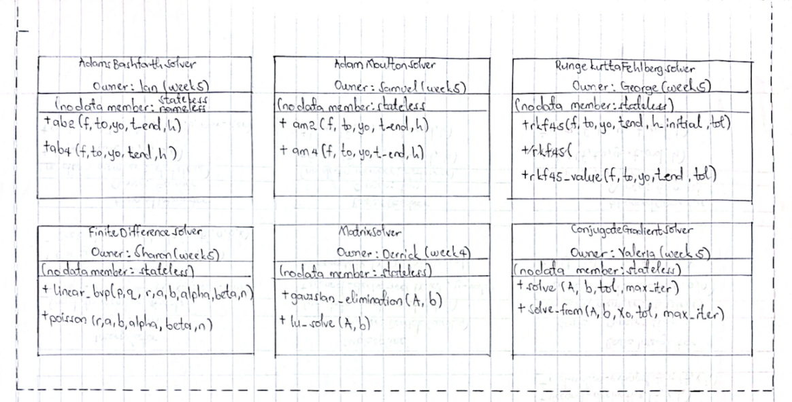
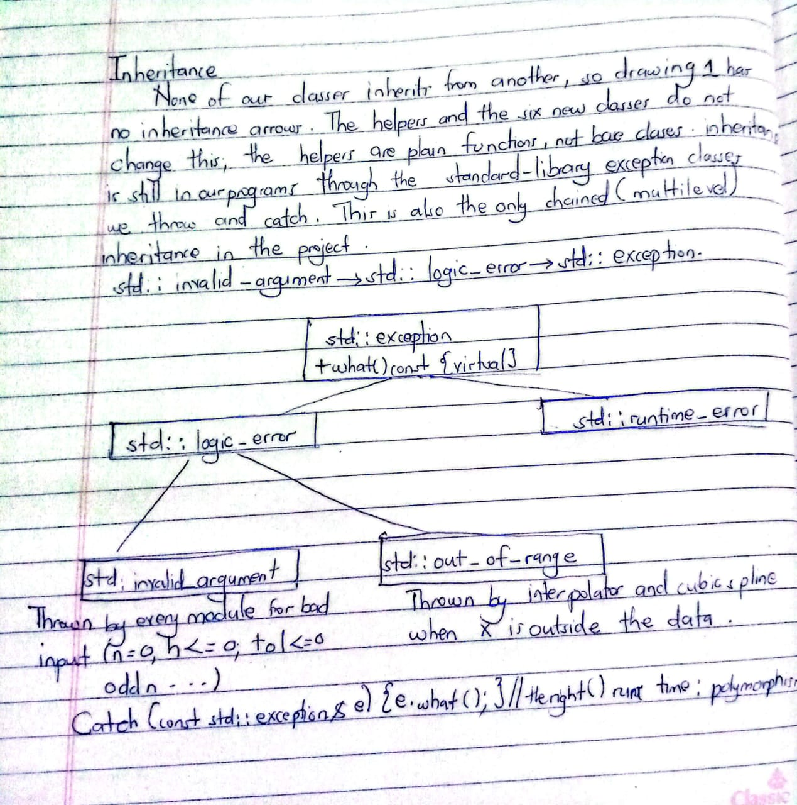

# OOP concepts used

## Class layouts




| Class | Owner | Data members | Member functions (all `public`) |
| :--- | :--- | :--- | :--- |
| **BasicRootFinder** | Jairus | none | `double bisection(std::function<double(double)> f, double a, double b, double tol, int max_iter)`<br>`double newton_raphson(std::function<double(double)> f, std::function<double(double)> df, double x0, double tol, int max_iter)` |
| **AdvancedRootFinder** | Valeria | none | `double secant_method(f, double x0, double x1, double tol, int max_iter)`<br>`double fixed_point_iteration(g, double x0, double tol, int max_iter)` |
| **NumericalDifferentiator** | Jairus | none | `double forward_difference(f, double x, double h)`<br>`double backward_difference(f, double x, double h)`<br>`double central_difference(f, double x, double h)`<br>`double second_derivative(f, double x, double h)`<br>`double richardson_extrapolation(f, double x, double h)` |
| **Interpolator** | Derrick | none | `double linear_interpolate(double x, const std::vector<double>& x_vals, const std::vector<double>& y_vals)`<br>`std::vector<double> chebyshev_nodes(double a, double b, int n)`<br>`std::vector<double> chebyshev_coefficients(f, double a, double b, int n)`<br>`double chebyshev_approximate(const std::vector<double>& coeffs, double a, double b, double x)` |
| **CubicSpline** | Derrick | none | `std::vector<double> second_derivatives(const std::vector<double>& x_vals, const std::vector<double>& y_vals)`<br>`double interpolate(double x, const std::vector<double>& x_vals, const std::vector<double>& y_vals)` |
| **BasicIntegrator** | Sharon | none | `double trapezoidal_rule(f, double a, double b, int n)`<br>`double midpoint_rule(f, double a, double b, int n)` |
| **AdvancedIntegrator** | George | none | `double simpsons_rule(f, double a, double b, int n)`<br>`double romberg_integration(f, double a, double b, int max_iter)` |
| **MatrixSolver** | Derrick | none | `std::vector<double> gaussian_elimination(const std::vector<std::vector<double>>& A, const std::vector<double>& b)`<br>`std::vector<double> lu_solve(same parameters)` |
| **BasicODESolver** | Ian | none | `std::vector<std::pair<double,double>> euler(std::function<double(double,double)> f, double t0, double y0, double t_end, double h)`<br>`... heun(same parameters)` |
| **AdvancedODESolver** | Samuel | none | `std::vector<std::pair<double,double>> rk4(f, double t0, double y0, double t_end, double h)`<br>`... rk3(same parameters)` |
| **AdamsBashforthSolver** | Ian  | none | `std::vector<std::pair<double,double>> ab2(f, double t0, double y0, double t_end, double h)`<br>`... ab4(same parameters)` |
| **AdamsMoultonSolver** | Samuel | none | `std::vector<std::pair<double,double>> am2(f, double t0, double y0, double t_end, double h)`<br>`... am4(same parameters)` |
| **RungeKuttaFehlbergSolver** | George | none | `std::vector<std::pair<double,double>> rkf45(f, double t0, double y0, double t_end, double h_initial, double tol)`<br>`double rkf45_value(f, double t0, double y0, double t_end, double tol)` |
| **FiniteDifferenceSolver** | Sharon | none | `std::vector<std::pair<double,double>> linear_bvp(p, q, r, double a, double b, double alpha, double beta, int n)`<br>`... poisson(r, double a, double b, double alpha, double beta, int n)` |
| **ConjugateGradientSolver** | Valeria | none | `std::vector<double> solve(const std::vector<std::vector<double>>& A, const std::vector<double>& b, double tol, int max_iter)`<br>`std::vector<double> solve_from(A, b, const std::vector<double>& x0, double tol, int max_iter)` |

##  Encapsulation

*   **Related behaviour is grouped in a class.** For example, `BasicIntegrator` holds the trapezoidal and midpoint rules.
*   **Interface and implementation are separate.** Declarations are in `include/numerical-computing/*.hpp` and the working code is in `src/*.cpp`, so a user needs only the header. Everything sits in `namespace numcomp`.
*   **Implementation details are hidden (new with the helpers).** The shared rules live in `src/internal/`. They are compiled into the library but their headers are not installed, so users cannot depend on them. Helpers used by only one file (`find_pivot_row`, `back_substitution`, `euler_step`, `rk4_step`, `ab4_step`, `solve_corrector`, `fehlberg_step`, `dot`, …) are `static`, which makes them private to that file.
*   **The caller's data is protected.** Data is taken as `const&`, so it cannot be changed. `MatrixSolver` copies `A` and `b` before eliminating, so the caller's matrix is unchanged after solving (this is tested).
*   **Bad input is rejected at the boundary.** Each method throws `invalid_argument`, `out_of_range` or `runtime_error` instead of working with invalid values. With the helpers, one rule gives one check and one message everywhere. A result that is not a finite number is never returned silently (`check_finite_result`).
*   **Limitation to state honestly:** there are no `private` members, because the classes keep no state, so there is nothing to hide inside an object. A class that stores data (for example a spline that keeps its coefficients after a `fit()`) would make that data `private`.

## Polymorphism

*   **Exceptions (real runtime polymorphism).** `what()` is a virtual function of `std::exception`. The app (`run_safely`), every example (`demo::section`) and the test framework catch through `const std::exception&` as the last handler. The call to `what()` runs the version belonging to the actual object:
    ```cpp
    catch (const std::exception& e) {
        ui::print_error("Unexpected error", e.what());
    }
    ```
*   **Function-pointer strategy (new, runtime).** `ode::run_fixed_steps` receives the step formula as a function pointer (`ode::StepRule`). The same loop behaves as Euler, Heun, RK3 or RK4 depending on which function is passed in. This is the _strategy_ idea without class inheritance:
    ```cpp
    return ode::run_fixed_steps(f, t0, y0, t_end, h, rk4_step);   // or euler_step, heun_step, rk3_step
    ```
    The multistep methods use the same idea with a second loop and a second pointer type, `ode::MultistepRule`:
    ```cpp
    return ode::run_multistep(f, t0, y0, t_end, h, 4, ab4_step);  // or ab2_step, am2_step, am4_step
    ```
*   **Templates (new, compile-time / parametric polymorphism).** One template works for many types: `test::expect_throw<std::invalid_argument>` and `test::expect_throw<std::runtime_error>`, `demo::section<Code>` for any lambda, and `catalog::names<Entry>` for any catalog list. These are in the helpers, tests, examples and app, not in the library's public classes.
*   **Interchangeable functions (a looser form).** The maths functions are passed as `std::function`, so a plain function, a lambda or a function object can be given to the same method.
*   **Not implemented:** our own virtual functions, abstract classes and function overloading.

## Inheritance



## Templates

### 1. Templates we have

| Template | File | Parameter | What it does |
| :--- | :--- | :--- | :--- |
| `run_safely<Code>` | `src/app/module_menus.cpp` | Code = any callable | Runs any lambda inside one try/catch, so 18 menu calls share one error handler |
| `names<Entry>` | `src/app/catalog.hpp` | Entry = any struct with a name | Builds menu labels for all eight problem tables |
| `demo::section<Code>` | `examples/example_helpers.hpp` | Code = any callable | Runs the body of one demo section |
| `demo::show_rejected<Code>` | `examples/example_helpers.hpp` | Code = any callable | Runs a call that should throw and prints the error |
| `test::expect_throw<Expected, Code>` | `tests/test_helpers.hpp` | Expected = exception type, Code = callable | One function checks every exception type |
| `test::expect_no_throw<Code>` | `tests/test_helpers.hpp` | Code = any callable | Checks that a call does not throw |
| `max_linear_error<F>` | `examples/example_interpolator_applied.cpp` | F = any callable | A local helper that measures an interpolation error for any function |

### 2. Why we use templates here

* **Code Reusability:** Instead of rewriting the same `try/catch` error-handling blocks or testing assertions for every single menu item or test case, a single template (like `run_safely` or `test::expect_throw`) handles all of them.
* **Flexibility with Callables:** By using template parameters like `Code` or `F`, the helper functions can accept any type of callable. This means we can pass in raw function pointers, lambdas (even with captured state), or functors without restriction.
* **Compile-Time Type Safety:** Templates like `test::expect_throw<Expected, Code>` allow us to specify the exact exception type (e.g., `std::invalid_argument`) at compile time. The compiler ensures we are checking for the precise error type we expect.
* **Performance without Overhead:** Passing a mathematical function or test execution as a template parameter allows the compiler to fully inline the code. This is much faster and requires less memory overhead than wrapping the code in a standard `std::function`.