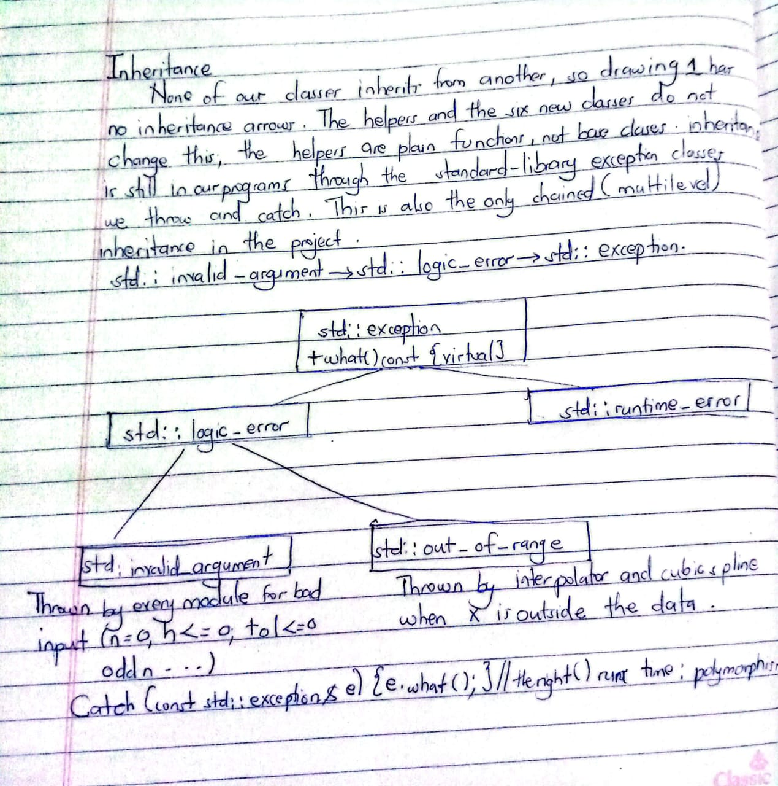
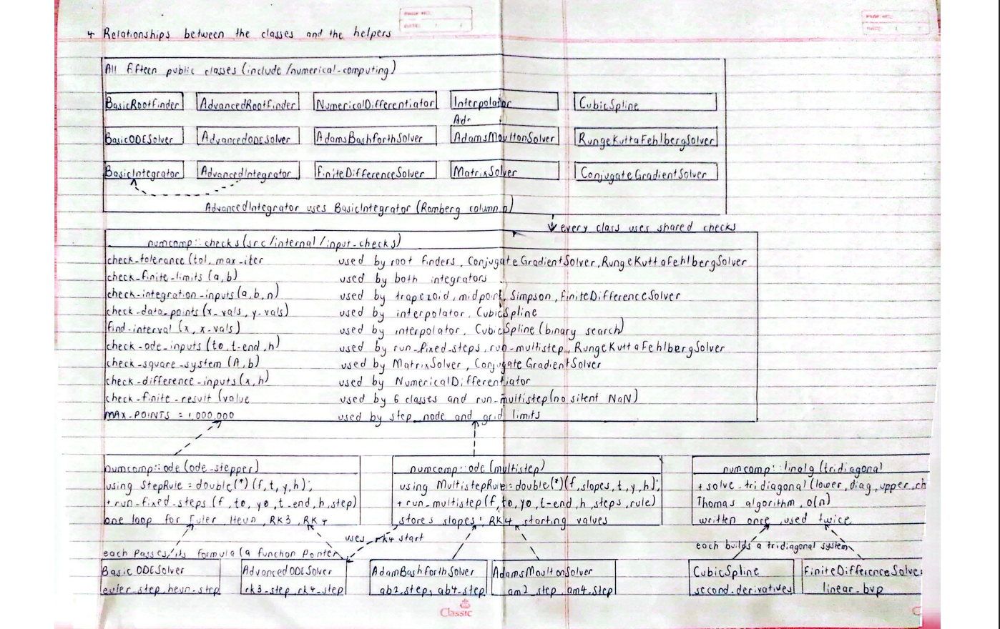
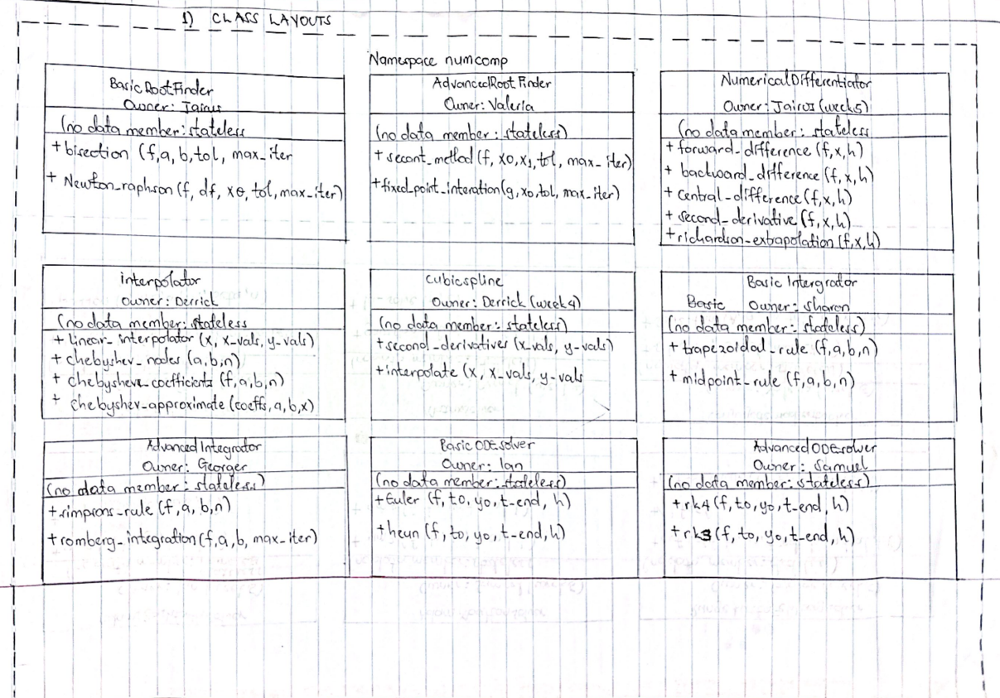
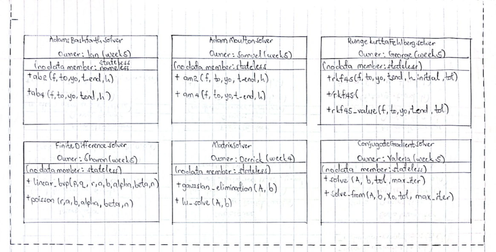

# General Report - Numerical Computing 2 (Group 23)

## Table of contents

[Group Members and Contributions](<General report.md#group-members-and-contributions>)

[Commit history proof of contribution](<General report.md#commit-history-proof-of-contribution>)

[Requirements and Dependencies](<General report.md#requirements-and-dependencies>)

[The Library at a Glance](<General report.md#the-library-at-a-glance>)

[Algorithm Implementation Summary](<General report.md#algorithm-implementation-summary-see-module-reports>)

[Command-line app: numcomp_app](<General report.md#command-line-app-numcomp_app>)

[Project Structure](<General report.md#project-structure>)

[OOP Concepts  used in our library](<General report.md#oop-concepts--used-in-our-library>)

[Building the library](<General report.md#building-the-library>)

[Install the Library (if your CMake supports it) ](<General report.md#install-the-library-if-your-cmake-supports-it>)

[Run the Tests and Documentation](<General report.md#run-the-tests-and-documentation>)

[Examples](<General report.md#examples>)

[Limitations](<General report.md#limitations>)

[Additional Documentation & Links](<General report.md#additional-documentation--links>)

[AI clause for entire project](<General report.md#ai-clause-for-entire-project>)

[References](<General report.md#references>)


## Group Members and Contributions

| Name | Student Number | Project Role / Assigned Module | 
| ----- | ----- | ----- | 
| CHEMISTO JAIRUS | 25/U/07928/PS | Member 1 (Lead) / BasicRootFinder / NumericalDifferentiator / shared helpers incl. the multistep loop and tridiagonal solver, CMake, merges, reports | 
| BATTE DERRICK CALVIN | 25/U/0717 | Member 2 / Interpolator incl. Chebyshev approximation, CubicSpline / MatrixSolver / Documentation of project / Building and Installing the project| 
| Aogon Sharon | 25/U/08690/PS | Member 3 / BasicIntegrator / FiniteDifferenceSolver / Class layouts(pdf) | 
| BAKALU VALERIA | 25/U/07924/PS | Member 4 / AdvancedRootFinder / ConjugateGradientSolver / Inheritance of the librabry(jpg) | 
| WASSWA GEORGE MPANGA | 25/U/08793/PS | Member 5 / AdvancedIntegrator / RungeKuttaFehlbergSolver | 
| MWANJE IAN | 25/U/08757/PS | Member 6 / BasicODESolver / AdamsBashforthSolver / ODE stepper | 
| MUWANGUZI SAMUEL | 25/U/0843 | Member 7 / AdvancedODESolver / AdamsMoultonSolver / ODE stepper | 
| KYEYUNE PRAISE PAULINE | 25/U/07943/PS | Member 8 / test framework/  test runner / Matrix Solver tests / QA; not linear algebra | 
| Nabakooza Bridget Maria | 25/U/07592/PS | Member 9 /  numcomp_app / examples build / example helpers / Relationship between Shared helpers and classes |  

## Commit history proof of contribution

You can view the contributions made by [Member 1(CHEMISTO JAIRUS)](https://github.com/Chemisto-Jairus/Numerical-Computing-Group-23/commits/main/?author=Chemisto-Jairus).

You can view the contributions made by [Member 2(BATTE DERRICK CALVIN)](https://github.com/Chemisto-Jairus/Numerical-Computing-Group-23/commits/main/?author=itsBDC).

You can view the contributions made by [Member 3(Aogon Sharon)](https://github.com/Chemisto-Jairus/Numerical-Computing-Group-23/commits/main/?author=Sharon17-cloud).

You can view the contributions made by [Member 4(BAKALU VALERIA)](https://github.com/Chemisto-Jairus/Numerical-Computing-Group-23/commits/main/?author=Bakaluvaleria).

You can view the contributions made by [Member 5(WASSWA GEORGE MPANGA)](https://github.com/Chemisto-Jairus/Numerical-Computing-Group-23/commits/main/?author=WASSWAGEORGE).

You can view the contributions made by [Member 6(MWANJE IAN)](https://github.com/Chemisto-Jairus/Numerical-Computing-Group-23/commits/main/?author=mwanjeian).

You can view the contributions made by [Member 7(MUWANGUZI SAMUEL)](https://github.com/Chemisto-Jairus/Numerical-Computing-Group-23/commits/main/?author=samvic292).

You can view the contributions made by [Member 8(KYEYUNE PRAISE PAULINE)](https://github.com/Chemisto-Jairus/Numerical-Computing-Group-23/commits/main/?author=kpraisepauline-hash).

You can view the contributions made by [Member 9(Nabakooza Bridget Maria)](https://github.com/Chemisto-Jairus/Numerical-Computing-Group-23/commits/main/?author=nabakoozabridgetmaria).

## Requirements and Dependencies

- **Compiler:** needs C++17 support. 
- **CMake:** version 3.10 or newer. 
- **Git:** only to clone the repository. 
- **Outside libraries:** None, everything is written by us from scratch.

## The Library at a Glance

| Class | Methods | Module guide | 
| ----- | ----- | ----- | 
| `BasicRootFinder` | Bisection, Newton-Raphson | [modules/basic_root_finder.md](../documentation/modules/basic_root_finder.md) | 
| `AdvancedRootFinder` | Secant, Fixed-point iteration | [modules/advanced_root_finder.md](../documentation/modules/advanced_root_finder.md) | 
| `Interpolator` | Linear interpolation, Chebyshev nodes, Chebyshev approximation | [modules/interpolator.md](../documentation/modules/interpolator.md) | 
| `CubicSpline` | Natural cubic spline | [modules/cubic_spline.md](../documentation/modules/cubic_spline.md) | 
| `NumericalDifferentiator` | Forward, backward, central differences, second derivative, Richardson | [modules/numerical_differentiator.md](../documentation/modules/numerical_differentiator.md) | 
| `BasicIntegrator` | Trapezoidal, Midpoint | [modules/basic_integrator.md](../documentation/modules/basic_integrator.md) | 
| `AdvancedIntegrator` | Simpson's 1/3, Romberg | [modules/advanced_integrator.md](../documentation/modules/advanced_integrator.md) | 
| `BasicODESolver` | Euler, Heun | [modules/basic_ode_solver.md](../documentation/modules/basic_ode_solver.md) | 
| `AdvancedODESolver` | RK3, RK4 | [modules/advanced_ode_solver.md](../documentation/modules/advanced_ode_solver.md) | 
| `AdamsBashforthSolver` | Adams-Bashforth 2 and 4 | [modules/adams_bashforth_solver.md](../documentation/modules/adams_bashforth_solver.md) | 
| `AdamsMoultonSolver` | Adams-Moulton 2 and 4 | [modules/adams_moulton_solver.md](../documentation/modules/adams_moulton_solver.md) | 
| `RungeKuttaFehlbergSolver` | Adaptive RKF45 | [modules/runge_kutta_fehlberg_solver.md](../documentation/modules/runge_kutta_fehlberg_solver.md) | 
| `FiniteDifferenceSolver` | Finite difference method for boundary value problems | [modules/finite_difference_solver.md](../documentation/modules/finite_difference_solver.md) | 
| `MatrixSolver` | Gaussian elimination, LU decomposition | [modules/matrix_solver.md](../documentation/modules/matrix_solver.md) | 
| `ConjugateGradientSolver` | Conjugate gradient | [modules/conjugate_gradient_solver.md](../documentation/modules/conjugate_gradient_solver.md) | 

## Algorithm Implementation Summary [See algorithm report](../documentation/algorithm-report.md)

The `numcomp2` library implements eighteen core algorithms and five related methods across seven mathematical areas. All logic is implemented in stateless classes, sharing central helpers (like tridiagonal solvers and generic ODE loops) to keep code DRY.

## Stateless Design in Numerical Computing

The stateless design was a highly effective architectural choice for the scope of this project because it heavily prioritizes code safety, predictability, and simplicity over extreme optimization. Software design is always a trade-off, and for a general-purpose numerical library aimed at small-to-medium datasets, this approach offers distinct advantages alongside a few performance penalties.

### Why it was a good idea

* **Guaranteed Safety:** Because the classes hold no private data, there is zero risk of stale variables corrupting subsequent calculations. Every function call starts with a clean slate, and inputs are safely passed by constant reference and copied internally so the caller's original data is never altered.

* **Architectural Uniformity:** All 15 classes in the library follow the exact same predictable pattern. Users only ever need to initialize a default constructor and pass their data directly to the method, making the API exceptionally easy to learn and test.

* **Aligned with the Scope:** The library is explicitly meant for small, dense systems (tens to a few hundreds of unknowns). At this scale, the CPU overhead required to recalculate an O(n) tridiagonal system or an O(n³) matrix from scratch is negligible.

### Where it sacrifices efficiency

* **Redundant LU Factorization:** The primary mathematical advantage of LU decomposition is factoring matrix A into L and U just once, which allows you to solve for many different b vectors in O(n²) time rather than O(n³). Because `MatrixSolver` is stateless, it discards L and U after every call, forcing a full refactorization every time the method is used.

* **Repeated Spline Generation:** The `CubicSpline` module must re-run the Thomas algorithm to calculate the second derivatives (M) from scratch on every single interpolate call. Evaluating 1,000 points on the same curve forces the O(n) algorithm to run 1,000 redundant times instead of just once.

### How Industry Libraries Handle This

Most industry-standard numerical computing libraries on the internet—such as SciPy, Eigen, and scikit-learn—primarily use a **stateful design** to maximize performance on large datasets. While stateless utility functions exist for one-off calculations, professional libraries store expensive intermediate mathematical results in memory to avoid redundant computation.

* **Python's SciPy:** In `scipy.interpolate.CubicSpline`, creating the spline object calculates and stores the polynomial coefficients as its state. When you evaluate the curve later, it strictly performs the fast O(log n) lookup and evaluation, bypassing the tridiagonal matrix math entirely.

* **C++ Eigen Library:** For linear algebra, Eigen uses stateful solver objects. If you initialize `Eigen::PartialPivLU`, the object computes and stores the LU decomposition. You can then call `.solve(b)` thousands of times in O(n²) time without ever repeating the heavy O(n³) factorization.

* **Scikit-Learn:** Data modeling libraries rely almost entirely on the stateful `fit()` and `predict()` pattern. The training phase saves the calculated weights as the object's state, which the prediction phase then applies to new inputs.

While a stateless approach guarantees safe memory handling and prevents side effects, real-world libraries accept the complexity of managing state because recalculating massive mathematical systems from scratch is computationally prohibitive.

### When do they choose which?

Real-world libraries do not use stateful classes for absolutely every module. They take a pragmatic, mixed approach, reserving stateful design specifically for the modules where it provides a mathematical or performance benefit.

### 1. When they use Stateful Classes

Libraries use stateful classes when a calculation involves an expensive "setup" phase that can be reused later.

* **Matrix Solvers:** Factorizing a matrix (like LU or Cholesky decomposition) is computationally heavy (O(n³)). Libraries use objects to store those factored matrices in memory so subsequent solves against new vectors are extremely fast (O(n²)).

* **Machine Learning Models:** Training a model takes significant time and computes thousands of weights and coefficients. Those weights *are* the state.

* **Spline Interpolation:** Calculating the second derivatives takes O(n) time. Spline objects calculate these once and save them so that looking up 10,000 different curve points later is instantaneous.

### 2. When they use Stateless Functions

They stick to simple, stateless functions when the calculation is a one-off operation or where there is no "setup" phase to save (exactly like your library's approach).

* **Root Finding (Bisection/Newton):** Finding the root of an equation is a one-time iterative loop. There are no heavy matrices to decompose and save, so SciPy just provides a standard function (`scipy.optimize.root_scalar`), which works exactly like your stateless `BasicRootFinder`.

* **Basic Numerical Integration:** Calculating the area under a curve using Simpson's or the Trapezoidal rule does not require saving intermediate states. SciPy provides functions like `scipy.integrate.simpson` that calculate the area from scratch and return the answer, leaving no memory trace behind (exactly like your `BasicIntegrator`).

### 1. Root Finding

Implements Bisection ($O(N)$), Newton-Raphson (quadratic), Secant (superlinear $1.618$), and Fixed-Point iteration. Safeguards include bracket checking, zero-derivative exceptions, and strict maximum iteration cutoffs.

### 2. Interpolation & Approximation

Features Piecewise Linear Interpolation and Natural Cubic Spline (solved in $O(N)$ without pivoting via the Thomas algorithm). It mitigates Runge's phenomenon using Chebyshev nodes and evaluates minimax polynomials via Clenshaw's recurrence algorithm in $O(N)$.

### 3. Differentiation

Evaluates derivatives using Forward/Backward (1st order) and Central/Second differences (2nd order). Utilizes Richardson Extrapolation for 4th-order accuracy, with safeguards addressing rounding errors at extremely small step sizes.

### 4. Integration

Implements Trapezoidal and Midpoint (2nd order), and Simpson's 1/3 rule (4th order). Utilizes Romberg integration to systematically eliminate even-powered error terms.

### 5. ODE Solvers (Initial Value Problems)

* **One-step:** Euler, Heun, RK3, and RK4.
* **Multistep:** Explicit Adams-Bashforth (AB2, AB4) and implicit Adams-Moulton (AM2, AM4). Implicit methods are resolved using fixed-point iteration on an Euler predictor.
* **Adaptive:** Runge-Kutta-Fehlberg (RKF45), which scales step size dynamically based on embedded error estimates bounded by user tolerance.

## 6. Linear & Boundary Value Systems

* **Linear Systems:** Gaussian Elimination and LU Decomposition using partial pivoting. Conjugate Gradient iterative solving for symmetric positive definite (SPD) systems.
* **BVPs:** Solves linear continuous models using the finite difference method, mapping central difference approximations onto a tridiagonal matrix to yield $O(h^2)$ precision.

## 7. Verification and Limitations

Verified via 15 standard test programs executing 335 rigorous checks. Exactness and expected theoretical convergence orders (e.g., halving step sizes yielding error reductions of 2, 4, or 16) have been mathematically verified across all methods. Identified limitations (such as explicit ODE instability on stiff problems, or lack of preconditioning in Conjugate Gradient) are thoroughly documented in individual module guides.

## Command-line app: numcomp_app

| | |
|---|---|
| Owners | Nabakooza Bridget Maria (Member 9), with Chemisto Jairus (Member 1) |
| Files | `src/main.cpp`, `src/app/console_ui.*`, `src/app/catalog.*`, `src/app/module_menus.*` |
| Build target | `numcomp_app` (linked against the `numcomp2` library) |


### 1. What it does

An interactive console program that demonstrates every method of the library. It opens with a large **GROUP 23** banner, then guides the user in three steps:

1. **Topic:** Root finding, Interpolation (and Chebyshev approximation), Differentiation, Integration, Initial value ODEs, Boundary value ODEs, Linear systems, or About. Every one of the 15 library classes is reachable.
2. **Method:** for example Bisection, Newton-Raphson, Secant, Fixed-point, or *Compare all*. The ODE topic first asks for a **family** (one-step, multistep, adaptive, or compare all nine methods), then for the method in that family.
3. **Problem:** a preset equation, function, integrand, model, boundary value problem, data set or matrix from the catalog, or the user's own (a custom cubic, custom data points, a custom linear ODE, a custom constant-coefficient BVP, a custom matrix up to 6×6).

Suggested parameters are shown in brackets, and **Enter accepts them**. Results appear next to the exact answer with the absolute error. Root finders also show the residual f(root) and the number of function evaluations.

### 2. Structure

| File | Role |
|---|---|
| `src/main.cpp` | Banner and main menu; dispatches to a topic menu; ends cleanly when the input ends. |
| `src/app/console_ui.*` | All input and output: line-based input with defaults and validation, numbered menus, framed headers, aligned results and tables, the banner. ASCII only, 78 columns wide. |
| `src/app/catalog.*` | Preset problems with their exact answers: 7 root equations, 5 fixed-point forms, 8 integrals (with antiderivatives, also used for Chebyshev approximation), 7 functions with exact first and second derivatives, 7 ODE models (with exact solutions), 5 boundary value problems (with exact solutions), 5 data sets, 8 linear systems (2 of them symmetric positive definite, for conjugate gradient). |
| `src/app/module_menus.*` | One menu per topic (seven topics and the About screen). Each calculation runs inside `run_safely`, which turns library exceptions into messages. |

### 3. How input is handled

- Input is read **one whole line at a time** (`std::getline`). A number must use the whole line: "2abc" is rejected, not read as 2.
- An empty line accepts the default shown in brackets.
- Menu choices must be whole numbers in range. Anything else gets a clear message and the question is asked again.
- A trailing `\r` (from Windows line endings) is removed.
- When input ends (Ctrl+D / Ctrl+Z, or the end of a piped file), a special `InputEnded` object is thrown. It is **not** derived from `std::exception`, so the calculation handlers do not catch it. `main()` catches it and exits with a goodbye message.

### 4. How errors are handled

Every library call runs inside `run_safely`, which catches from the most specific type to the most general:

| Caught | Message prefix |
|---|---|
| `std::invalid_argument` | `[!] Invalid input:` |
| `std::out_of_range` | `[!] Out of range:` |
| `std::runtime_error` | `[!] Calculation failed:` |
| `std::exception` (anything else, e.g. `bad_alloc`) | `[!] Unexpected error:` |

Results are computed **before** anything is printed, so an error never leaves a half-printed line. In the "compare" screens every method runs in its own handler. For example, conjugate gradient can reject a non-symmetric matrix while Gaussian elimination and LU still show their answers.

### 4a. What each topic offers

| Topic | Methods | Extra screens |
|---|---|---|
| Root finding | Bisection, Newton-Raphson, Secant, Fixed-point | compare three methods (with function-evaluation counts) |
| Interpolation | Linear, cubic spline, Chebyshev nodes, Chebyshev approximation | compare linear and spline; approximation error table |
| Differentiation | Forward, backward, central, second derivative, Richardson | error table for h = 0.1 … 1e-6 (shows rounding taking over) |
| Integration | Trapezoidal, Midpoint, Simpson, Romberg | compare all four |
| Initial value ODEs | One-step: Euler, Heun, RK3, RK4; multistep: AB2, AB4, AM2, AM4; adaptive: RKF45 | compare all nine at t_end; RKF45 table shows the step used |
| Boundary value ODEs | Finite difference method | convergence study n = 10 … 80 with error ratios |
| Linear systems | Gaussian elimination, LU, conjugate gradient | compare all three, with residuals |

### 5. Why it is written this way

| Decision | Reason |
|---|---|
| Separate `app/` files instead of one long main.cpp | Each file has one job (screen, data, menus), so each is short enough to read and test. |
| Catalog entries carry exact answers | The app can show the error for every method, which is the point of a numerical-methods demo. |
| "Compare all" options | Shows side by side why one method is preferred over another (accuracy, evaluations). |
| ODE methods grouped by family | Nine methods in one list is hard to read; the family question also teaches how the methods differ. |
| Tables with five or more columns use narrower columns; long error messages are wrapped | Every line stays within 78 characters. |
| ASCII-only output | Box-drawing characters show as garbage in the default Windows console. |
| Defaults for every parameter | A first-time user can press Enter through a whole demo. |

### Building and running in git bash

```bash
cmake -G "MinGW Makefiles" -S . -B build
cmake --build build
./build/numcomp_app.exe
```


## Project Structure

We used the following structure for our project:

```

Numerical-Computing-Group-23/
├── documentation/
│   │
│   │   
│   │ 
│   ├── guides/
│   │       ├── doxygen_comments_guide.md
│   │       ├── install_guide.md
│   │       └── build_guide.md
│   │
│   │
│   ├── examples results 
│   │       ├── results_adams_bashforth_solver.md
│   │       ├── results_adams_moulton_solver.md
│   │       ├── results_advanced_integrator.md
│   │       ├── results_advanced_ode_solver.md
│   │       ├── results_advanced_root_finder.md
│   │       ├── results_basic_integrator.md
│   │       ├── results_basic_ode_solver.md
│   │       ├── results_basic_root_finder.md
│   │       ├── results_conjugate_gradient_solver.md
│   │       ├── results_cubic_spline.md
│   │       ├── results_finite_difference_solver.md
│   │       ├── results_interpolator.md
│   │       ├── results_matrix_solver.md
│   │       ├── results_numerical_differentiator.md
│   │       └── results_runge_kutta_fehlberg_solver.md
│   │        
│   ├── modules/ 
│   │   ├── adams_bashforth_solver.md
│   │   ├── adams_moulton_solver.md
│   │   ├── advanced_integrator.md
│   │   ├── advanced_ode_solver.md
│   │   ├── advanced_root_finder.md
│   │   ├── basic_integrator.md
│   │   ├── basic_ode_solver.md
│   │   ├── basic_root_finder.md
│   │   ├── command_line_app.md
│   │   ├── conjugate_gradient_solver.md
│   │   ├── cubic_spline.md
│   │   ├── examples.md
│   │   ├── finite_difference_solver.md
│   │   ├── interpolator.md
│   │   ├── matrix_solver.md
│   │   ├── numerical_differentiator.md
│   │   ├── runge_kutta_fehlberg_solver.md
│   │   ├── shared_helpers.md
│   │   └── test_framework.md
│   │
│   ├── test results 
│   │       ├── test_results_adams_bashforth_solver.md
│   │       ├── test_results_adams_moulton_solver.md
│   │       ├── test_results_advanced_integrator.md
│   │       ├── test_results_advanced_ode_solver.md
│   │       ├── test_results_advanced_root_finder.md
│   │       ├── test_results_basic_integrator.md
│   │       ├── test_results_basic_ode_solver.md
│   │       ├── test_results_basic_root_finder.md
│   │       ├── test_results_conjugate_gradient_solver.md
│   │       ├── test_results_cubic_spline.md
│   │       ├── test_results_finite_difference_solver.md
│   │       ├── test_results_interpolator.md
│   │       ├── test_results_matrix_solver.md
│   │       ├── test_results_numerical_differentiator.md
│   │       └── test_results_runge_kutta_fehlberg_solver.md
│   ├── README.md 
│   ├── algorithm-report.md 
│   ├── Inheritance of Numcomp2 by Valeria.jpg
│   ├── Shared helpers by Bridget.pdf
│   ├── Class layouts by Sharon.pdf
│   └── testing.md 
├── examples/
│   ├── CMakeLists.txt
│   ├── example_adams_bashforth_solver.cpp
│   ├── example_adams_bashforth_solver_applied.cpp
│   ├── example_adams_moulton_solver.cpp
│   ├── example_adams_moulton_solver_applied.cpp
│   ├── example_advanced_integrator.cpp
│   ├── example_advanced_integrator_applied.cpp
│   ├── example_advanced_ode_solver.cpp
│   ├── example_advanced_ode_solver_applied.cpp
│   ├── example_advanced_root_finder.cpp
│   ├── example_advanced_root_finder_applied.cpp
│   ├── example_basic_integrator.cpp
│   ├── example_basic_integrator_applied.cpp
│   ├── example_basic_ode_solver.cpp
│   ├── example_basic_ode_solver_applied.cpp
│   ├── example_basic_root_finder.cpp
│   ├── example_basic_root_finder_applied.cpp
│   ├── example_conjugate_gradient_solver.cpp
│   ├── example_conjugate_gradient_solver_applied.cpp
│   ├── example_cubic_spline.cpp
│   ├── example_cubic_spline_applied.cpp
│   ├── example_finite_difference_solver.cpp
│   ├── example_finite_difference_solver_applied.cpp
│   ├── example_interpolator.cpp
│   ├── example_interpolator_applied.cpp
│   ├── example_matrix_solver.cpp
│   ├── example_matrix_solver_applied.cpp
│   ├── example_numerical_differentiator.cpp
│   ├── example_numerical_differentiator_applied.cpp
│   ├── example_runge_kutta_fehlberg_solver.cpp
│   └── example_runge_kutta_fehlberg_solver_applied.cpp
├── include/
│   └── numerical-computing/
│       ├── adams_bashforth_solver.hpp 
│       ├── adams_moulton_solver.hpp 
│       ├── advanced_integrator.hpp
│       ├── advanced_ode_solver.hpp
│       ├── advanced_root_finder.hpp
│       ├── basic_integrator.hpp
│       ├── basic_ode_solver.hpp
│       ├── basic_root_finder.hpp
│       ├── conjugate_gradient_solver.hpp 
│       ├── cubic_spline.hpp
│       ├── finite_difference_solver.hpp 
│       ├── interpolator.hpp
│       ├── matrix_solver.hpp
│       ├── numcomp.hpp 
│       ├── numerical_differentiator.hpp 
│       └── runge_kutta_fehlberg_solver.hpp 
├── reports/
│   ├── week-01.md
│   ├── week-02.md
│   ├── week-03.md
│   ├── week-04.md
│   ├── Final week report.md
│   ├── debug report (week 01 to week 03).md 
│   └── General report.md 
├── src/
│   ├── app/ 
│   │   ├── catalog.cpp
│   │   ├── catalog.hpp
│   │   ├── console_ui.cpp
│   │   ├── console_ui.hpp
│   │   ├── module_menus.cpp
│   │   └── module_menus.hpp
│   ├── internal/
│   │   ├── input_checks.cpp
│   │   ├── input_checks.hpp
│   │   ├── multistep.cpp 
│   │   ├── multistep.hpp 
│   │   ├── ode_stepper.cpp
│   │   ├── ode_stepper.hpp
│   │   ├── tridiagonal.cpp 
│   │   └── tridiagonal.hpp 
│   ├── adams_bashforth_solver.cpp 
│   ├── adams_moulton_solver.cpp 
│   ├── advanced_integrator.cpp 
│   ├── advanced_ode_solver.cpp
│   ├── advanced_root_finder.cpp
│   ├── basic_integrator.cpp
│   ├── basic_ode_solver.cpp
│   ├── basic_root_finder.cpp
│   ├── conjugate_gradient_solver.cpp 
│   ├── cubic_spline.cpp
│   ├── finite_difference_solver.cpp 
│   ├── interpolator.cpp
│   ├── main.cpp
│   ├── matrix_solver.cpp
│   ├── numerical_differentiator.cpp
│   └── runge_kutta_fehlberg_solver.cpp 
├── tests/
│   ├── CMakeLists.txt
│   ├── run_all_tests.sh 
│   ├── test_adams_bashforth_solver.cpp 
│   ├── test_adams_moulton_solver.cpp 
│   ├── test_advanced_integrator.cpp
│   ├── test_advanced_ode_solver.cpp
│   ├── test_advanced_root_finder.cpp
│   ├── test_basic_integrator.cpp
│   ├── test_basic_ode_solver.cpp
│   ├── test_basic_root_finder.cpp
│   ├── test_conjugate_gradient_solver.cpp 
│   ├── test_cubic_spline.cpp
│   ├── test_finite_difference_solver.cpp 
│   ├── test_helpers.hpp
│   ├── test_interpolator.cpp
│   ├── test_matrix_solver.cpp
│   ├── test_numerical_differentiator.cpp 
│   └── test_runge_kutta_fehlberg_solver.cpp 
├── .gitattributes
├── .gitignore
├── CMakeLists.txt
├── Doxyfile
├── LICENSE
└── README.md

```

## OOP Concepts  used in our library

### Inheritance of our library



### Relationship between Shared helpers and classes by Bridget



### Class layouts




| Class | Owner | Data members | Member functions (all `public`) |
| :--- | :--- | :--- | :--- |
| **BasicRootFinder** | Jairus | none | `double bisection(std::function<double(double)> f, double a, double b, double tol, int max_iter)`<br>`double newton_raphson(std::function<double(double)> f, std::function<double(double)> df, double x0, double tol, int max_iter)` |
| **AdvancedRootFinder** | Valeria | none | `double secant_method(f, double x0, double x1, double tol, int max_iter)`<br>`double fixed_point_iteration(g, double x0, double tol, int max_iter)` |
| **NumericalDifferentiator** | Jairus | none | `double forward_difference(f, double x, double h)`<br>`double backward_difference(f, double x, double h)`<br>`double central_difference(f, double x, double h)`<br>`double second_derivative(f, double x, double h)`<br>`double richardson_extrapolation(f, double x, double h)` |
| **Interpolator** | Derrick | none | `double linear_interpolate(double x, const std::vector<double>& x_vals, const std::vector<double>& y_vals)`<br>`std::vector<double> chebyshev_nodes(double a, double b, int n)`<br>`std::vector<double> chebyshev_coefficients(f, double a, double b, int n)`<br>`double chebyshev_approximate(const std::vector<double>& coeffs, double a, double b, double x)` |
| **CubicSpline** | Derrick | none | `std::vector<double> second_derivatives(const std::vector<double>& x_vals, const std::vector<double>& y_vals)`<br>`double interpolate(double x, const std::vector<double>& x_vals, const std::vector<double>& y_vals)` |
| **BasicIntegrator** | Sharon | none | `double trapezoidal_rule(f, double a, double b, int n)`<br>`double midpoint_rule(f, double a, double b, int n)` |
| **AdvancedIntegrator** | George | none | `double simpsons_rule(f, double a, double b, int n)`<br>`double romberg_integration(f, double a, double b, int max_iter)` |
| **MatrixSolver** | Derrick | none | `std::vector<double> gaussian_elimination(const std::vector<std::vector<double>>& A, const std::vector<double>& b)`<br>`std::vector<double> lu_solve(same parameters)` |
| **BasicODESolver** | Ian | none | `std::vector<std::pair<double,double>> euler(std::function<double(double,double)> f, double t0, double y0, double t_end, double h)`<br>`... heun(same parameters)` |
| **AdvancedODESolver** | Samuel | none | `std::vector<std::pair<double,double>> rk4(f, double t0, double y0, double t_end, double h)`<br>`... rk3(same parameters)` |
| **AdamsBashforthSolver** | Ian  | none | `std::vector<std::pair<double,double>> ab2(f, double t0, double y0, double t_end, double h)`<br>`... ab4(same parameters)` |
| **AdamsMoultonSolver** | Samuel | none | `std::vector<std::pair<double,double>> am2(f, double t0, double y0, double t_end, double h)`<br>`... am4(same parameters)` |
| **RungeKuttaFehlbergSolver** | George | none | `std::vector<std::pair<double,double>> rkf45(f, double t0, double y0, double t_end, double h_initial, double tol)`<br>`double rkf45_value(f, double t0, double y0, double t_end, double tol)` |
| **FiniteDifferenceSolver** | Sharon | none | `std::vector<std::pair<double,double>> linear_bvp(p, q, r, double a, double b, double alpha, double beta, int n)`<br>`... poisson(r, double a, double b, double alpha, double beta, int n)` |
| **ConjugateGradientSolver** | Valeria | none | `std::vector<double> solve(const std::vector<std::vector<double>>& A, const std::vector<double>& b, double tol, int max_iter)`<br>`std::vector<double> solve_from(A, b, const std::vector<double>& x0, double tol, int max_iter)` |

##  Encapsulation

*   **Related behaviour is grouped in a class.** For example, `BasicIntegrator` holds the trapezoidal and midpoint rules.
*   **Interface and implementation are separate.** Declarations are in `include/numerical-computing/*.hpp` and the working code is in `src/*.cpp`, so a user needs only the header. Everything sits in `namespace numcomp`.
*   **Implementation details are hidden (new with the helpers).** The shared rules live in `src/internal/`. They are compiled into the library but their headers are not installed, so users cannot depend on them. Helpers used by only one file (`find_pivot_row`, `back_substitution`, `euler_step`, `rk4_step`, `ab4_step`, `solve_corrector`, `fehlberg_step`, `dot`, …) are `static`, which makes them private to that file.
*   **The caller's data is protected.** Data is taken as `const&`, so it cannot be changed. `MatrixSolver` copies `A` and `b` before eliminating, so the caller's matrix is unchanged after solving (this is tested).
*   **Bad input is rejected at the boundary.** Each method throws `invalid_argument`, `out_of_range` or `runtime_error` instead of working with invalid values. With the helpers, one rule gives one check and one message everywhere. A result that is not a finite number is never returned silently (`check_finite_result`).
*   **Limitation to state honestly:** there are no `private` members, because the classes keep no state, so there is nothing to hide inside an object. A class that stores data (for example a spline that keeps its coefficients after a `fit()`) would make that data `private`.

## Polymorphism

*   **Exceptions (real runtime polymorphism).** `what()` is a virtual function of `std::exception`. The app (`run_safely`), every example (`demo::section`) and the test framework catch through `const std::exception&` as the last handler. The call to `what()` runs the version belonging to the actual object:
    ```cpp
    catch (const std::exception& e) {
        ui::print_error("Unexpected error", e.what());
    }
    ```
*   **Function-pointer strategy (new, runtime).** `ode::run_fixed_steps` receives the step formula as a function pointer (`ode::StepRule`). The same loop behaves as Euler, Heun, RK3 or RK4 depending on which function is passed in. This is the _strategy_ idea without class inheritance:
    ```cpp
    return ode::run_fixed_steps(f, t0, y0, t_end, h, rk4_step);   // or euler_step, heun_step, rk3_step
    ```
    The multistep methods use the same idea with a second loop and a second pointer type, `ode::MultistepRule`:
    ```cpp
    return ode::run_multistep(f, t0, y0, t_end, h, 4, ab4_step);  // or ab2_step, am2_step, am4_step
    ```
*   **Templates (new, compile-time / parametric polymorphism).** One template works for many types: `test::expect_throw<std::invalid_argument>` and `test::expect_throw<std::runtime_error>`, `demo::section<Code>` for any lambda, and `catalog::names<Entry>` for any catalog list. These are in the helpers, tests, examples and app, not in the library's public classes.
*   **Interchangeable functions (a looser form).** The maths functions are passed as `std::function`, so a plain function, a lambda or a function object can be given to the same method.
*   **Not implemented:** our own virtual functions, abstract classes and function overloading.

## Templates

### 1. Templates we have

| Template | File | Parameter | What it does |
| :--- | :--- | :--- | :--- |
| `run_safely<Code>` | `src/app/module_menus.cpp` | Code = any callable | Runs any lambda inside one try/catch, so 18 menu calls share one error handler |
| `names<Entry>` | `src/app/catalog.hpp` | Entry = any struct with a name | Builds menu labels for all eight problem tables |
| `demo::section<Code>` | `examples/example_helpers.hpp` | Code = any callable | Runs the body of one demo section |
| `demo::show_rejected<Code>` | `examples/example_helpers.hpp` | Code = any callable | Runs a call that should throw and prints the error |
| `test::expect_throw<Expected, Code>` | `tests/test_helpers.hpp` | Expected = exception type, Code = callable | One function checks every exception type |
| `test::expect_no_throw<Code>` | `tests/test_helpers.hpp` | Code = any callable | Checks that a call does not throw |
| `max_linear_error<F>` | `examples/example_interpolator_applied.cpp` | F = any callable | A local helper that measures an interpolation error for any function |

### 2. Why we use templates here

* **Code Reusability:** Instead of rewriting the same `try/catch` error-handling blocks or testing assertions for every single menu item or test case, a single template (like `run_safely` or `test::expect_throw`) handles all of them.
* **Flexibility with Callables:** By using template parameters like `Code` or `F`, the helper functions can accept any type of callable. This means we can pass in raw function pointers, lambdas (even with captured state), or functors without restriction.
* **Compile-Time Type Safety:** Templates like `test::expect_throw<Expected, Code>` allow us to specify the exact exception type (e.g., `std::invalid_argument`) at compile time. The compiler ensures we are checking for the precise error type we expect.
* **Performance without Overhead:** Passing a mathematical function or test execution as a template parameter allows the compiler to fully inline the code. This is much faster and requires less memory overhead than wrapping the code in a standard `std::function`.


## Shared internal helpers: input checks, ODE loops and the tridiagonal solver

| | |
|---|---|
| Owners | `input_checks`, `multistep`, `tridiagonal`: Chemisto Jairus (Member 1); `ode_stepper`: Mwanje Ian (Member 6) and Muwanguzi Samuel (Member 7) |
| Files | `src/internal/input_checks.hpp/.cpp`, `src/internal/ode_stepper.hpp/.cpp`, `src/internal/multistep.hpp/.cpp`, `src/internal/tridiagonal.hpp/.cpp` |
| Public? | **No.** These live in `src/internal/`, not in `include/`, so library users never see them. |

### 1. Why they exist

The project rules say the library should "avoid unnecessary duplication of code" (Section 3). Before these helpers:
- the same `tol`/`max_iter` check was typed in four root-finding methods;
- the same "x strictly increasing" loop appeared in two classes;
- the ~30-line ODE time loop was copied into four methods.

A fix to one copy did not reach the others, and the error messages could drift apart. Now each rule is written **once** and every method calls it.

### 2. `numcomp::checks` (input_checks)

| Function | Rule enforced | Used by |
|---|---|---|
| `check_tolerance(tol, max_iter)` | tol > 0 (and not NaN), max_iter > 0 | the 4 root finders, conjugate gradient, RKF45 |
| `check_finite_limits(a, b)` | a and b are finite numbers | all 4 integration methods |
| `check_integration_inputs(a, b, n)` | n > 0 and finite limits | trapezoidal, midpoint, Simpson, finite difference BVP |
| `check_data_points(x_vals, y_vals)` | same sizes, ≥ 2 points, x strictly increasing (no NaN) | linear interpolation, cubic spline |
| `find_interval(x, x_vals)` | x inside the data, and *which* interval (binary search, O(log n)) | linear interpolation, cubic spline |
| `check_ode_inputs(t0, t_end, h)` | h > 0, t_end > t0, ≤ 1,000,000 steps | both ODE loops (Euler, Heun, RK3, RK4, AB2, AB4, AM2, AM4) and RKF45 |
| `check_square_system(A, b)` | A non-empty and square, b the right size | Gaussian elimination, LU, conjugate gradient |
| `check_difference_inputs(x, h)` | x finite, h > 0 and finite | all 5 differentiation formulas |
| `check_finite_result(value)` | a computed value is finite (`runtime_error` otherwise) | differentiation, Chebyshev coefficients, multistep loop, Adams-Moulton corrector, RKF45, finite differences |
| `MAX_POINTS` (constant) | 1,000,000 | ODE step cap, Chebyshev node cap, finite difference grid cap |

Every function either returns normally or throws the documented exception (`invalid_argument`; `out_of_range` for `find_interval`; `runtime_error` for `check_finite_result`). The comparisons are written as `!(tol > 0)` and `!(x[i] < x[i+1])`. Every comparison involving NaN is false, so this form rejects NaN, while `tol <= 0` would accept it.

### 3. `numcomp::ode` (ode_stepper)

```cpp
using ODEFunction = std::function<double(double, double)>;
using StepRule    = double (*)(const ODEFunction& f, double t, double y, double h);

std::vector<std::pair<double, double>>
run_fixed_steps(const ODEFunction& f, double t0, double y0, double t_end, double h, StepRule step);
```

`run_fixed_steps` does everything the four ODE methods have in common: checks, storing the curve, shortening the last step, and landing exactly on t_end. The only thing it does not know is the formula for one step, which each method passes as a **function pointer**:

```cpp
static double euler_step(const ode::ODEFunction& f, double t, double y, double h) { return y + h * f(t, y); }

std::vector<std::pair<double, double>> BasicODESolver::euler(/* f, t0, y0, t_end, h */) 
{
    return ode::run_fixed_steps(f, t0, y0, t_end, h, euler_step);
}
```

This is the *strategy* idea without class inheritance. The loop is fixed, and the varying part is plugged in. A named function pointer was chosen over a lambda or a virtual class because it is the easiest form to read and explain.

### 4. `numcomp::ode::run_multistep` (multistep, Week 5)

```cpp
using MultistepRule = double (*)(const ODEFunction& f, const std::vector<double>& slopes, double t, double y, double h);

std::vector<std::pair<double, double>>
run_multistep(const ODEFunction& f, double t0, double y0, double t_end, double h, int steps, MultistepRule rule);
```

The same idea as `run_fixed_steps`, for methods that use several earlier slopes (Adams-Bashforth and Adams-Moulton). The loop:
- checks the inputs (`check_ode_inputs`);
- evaluates f **once** per point and stores the slope, so an explicit step costs one new evaluation;
- creates the first `steps − 1` points with RK4, by calling the public `AdvancedODESolver::rk4`, because the multistep formula needs earlier slopes that do not exist yet at t0;
- also uses RK4 for a final step shorter than h (the Adams weights assume equal spacing);
- checks every new value is finite and lands exactly on t_end.

Each method supplies only its formula as a `MultistepRule`, for example `ab4_step` or `am4_step`.

### 5. `numcomp::linalg::solve_tridiagonal` (tridiagonal, Week 5)

```cpp
std::vector<double> solve_tridiagonal(std::vector<double> lower, std::vector<double> diag,
                                      std::vector<double> upper, std::vector<double> rhs);
```

The Thomas algorithm: a forward sweep removes the sub-diagonal, then back substitution finds x from the last row up. It takes O(m) operations for m unknowns. It used to live inside `CubicSpline::second_derivatives`. The finite difference method needs exactly the same solver, so it moved here, and both classes call it. A zero pivot throws `runtime_error`; vectors of different sizes throw `invalid_argument`.

### 6. Other shared code (not in src/internal)

| Helper | Where | Shared by |
|---|---|---|
| `find_pivot_row`, `back_substitution` (`static`) | `src/matrix_solver.cpp` | Gaussian elimination and LU |
| `BasicIntegrator::trapezoidal_rule` (reused) | `src/advanced_integrator.cpp` | Romberg's first column (composition between classes) |
| `AdvancedODESolver::rk4` (reused) | `src/internal/multistep.cpp` | starting values of Adams-Bashforth and Adams-Moulton |
| `Interpolator::chebyshev_nodes` (reused) | `src/interpolator.cpp` | Chebyshev approximation samples f at these nodes |
| `NumericalDifferentiator::central_difference` (reused) | `src/numerical_differentiator.cpp` | Richardson extrapolation |
| `dot`, `multiply`, `check_symmetric` (`static`) | `src/conjugate_gradient_solver.cpp` | the conjugate gradient iteration |
| `solve_corrector` (`static`) | `src/adams_moulton_solver.cpp` | AM2 and AM4 |
| `test_helpers.hpp` | `tests/` | all 15 test programs (see `test_framework.md`) |
| `example_helpers.hpp` | `examples/` | all 30 example programs (see `examples.md`) |
| `app::ui`, `app::catalog` | `src/app/` | every screen of the command-line app (see `command_line_app.md`) |

### 7. Effect

| | Copies without helpers | Copies with helpers |
|---|---|---|
| tol/max_iter check | 6 | 1 |
| finite-limits check | 4 | 1 |
| strictly-increasing loop | 2 | 1 |
| fixed-step ODE loop | 4 | 1 |
| multistep loop with RK4 start | 4 | 1 |
| Thomas algorithm | 2 | 1 |
| RK4 step | 2 | 1 |
| pivot search / back substitution | 2 / 2 | 1 / 1 |

The helpers are internal, so the public headers do not depend on them.


## Building the library

## Windows Build

### (USING Cmake/Git bash)

**1. How to install Cmake**

- Open Command prompt on your pc and enter this code

```bash

winget install -e --id Kitware.CMake

``` 

**2. Building the library**

- Run Git bash as administrator and right click on the repository folder and select open git bash here
- Paste the code below in your git bash terminal

```bash

# ==========================================
# 1. SETUP SAFE ENVIRONMENT
# ==========================================
ORIGINAL_DIR=$(pwd)
SAFE_DIR="$HOME/Group23_Safe_Build"

echo "📦 Creating restriction-free build folder at: $SAFE_DIR"
rm -rf "$SAFE_DIR"
mkdir -p "$SAFE_DIR"
cp -r . "$SAFE_DIR"
cd "$SAFE_DIR"

# ==========================================
# 2. CHECK FILES & ADJUST FOR CMAKE
# ==========================================
LIB="src/adams_bashforth_solver.cpp \
src/adams_moulton_solver.cpp \
src/advanced_integrator.cpp \
src/advanced_ode_solver.cpp \
src/advanced_root_finder.cpp \
src/basic_integrator.cpp \
src/basic_ode_solver.cpp \
src/basic_root_finder.cpp \
src/conjugate_gradient_solver.cpp \
src/cubic_spline.cpp \
src/finite_difference_solver.cpp \
src/interpolator.cpp \
src/matrix_solver.cpp \
src/numerical_differentiator.cpp \
src/runge_kutta_fehlberg_solver.cpp"

echo ">>> Checking for missing source files..."
for file in $LIB; do
    if [ ! -f "$file" ]; then
        echo "⚠️ Warning: Source file '$file' is missing. Creating a dummy file to prevent CMake errors..."
        touch "$file"
    fi
done

# ==========================================
# 3. CMAKE BUILD
# ==========================================
mkdir -p build
cd build

echo ">>> Configuring CMake..."
cmake -G "MinGW Makefiles" ..

echo ">>> Compiling with CMake..."
cmake --build .

# ==========================================
# 4. FINISH & OPEN EXPLORER
# ==========================================
echo ">>> Opening build folder in Windows File Explorer..."
explorer .

cd "$ORIGINAL_DIR"
echo "✅ Finished! The library has been built inside $SAFE_DIR/build."

```

- It should open the folder where the build was created and you can run the numcomp_app.


## macOS/Linux build

### Using CMake and Homebrew

- If your macOS has no compiler, paste this code in the terminal to get it.

```bash

xcode-select --install

```

- If you also do not have CMake installed on your macOS, paste this code inside Homebrew.

```bash

brew install cmake

```

- Now to build the library and the app, paste this code in your new terminal in vs code while inside the repository folder.
- It should open the folder where the numcomp_app executable is located.

```bash

# ==========================================
# 1. SETUP SAFE ENVIRONMENT
# ==========================================
ORIGINAL_DIR=$(pwd)
SAFE_DIR="$HOME/Group23_Safe_Build"

echo "📦 Creating restriction-free build folder at: $SAFE_DIR"
rm -rf "$SAFE_DIR"
mkdir -p "$SAFE_DIR"
cp -r . "$SAFE_DIR"
cd "$SAFE_DIR"

# ==========================================
# 2. CHECK FILES & ADJUST FOR CMAKE
# ==========================================
LIB="src/adams_bashforth_solver.cpp \
src/adams_moulton_solver.cpp \
src/advanced_integrator.cpp \
src/advanced_ode_solver.cpp \
src/advanced_root_finder.cpp \
src/basic_integrator.cpp \
src/basic_ode_solver.cpp \
src/basic_root_finder.cpp \
src/conjugate_gradient_solver.cpp \
src/cubic_spline.cpp \
src/finite_difference_solver.cpp \
src/interpolator.cpp \
src/matrix_solver.cpp \
src/numerical_differentiator.cpp \
src/runge_kutta_fehlberg_solver.cpp"

echo ">>> Checking for missing source files..."
for file in $LIB; do
    if [ ! -f "$file" ]; then
        echo "⚠️ Warning: Source file '$file' is missing. Creating a dummy file to prevent CMake errors..."
        touch "$file"
    fi
done

# ==========================================
# 3. CMAKE BUILD
# ==========================================
mkdir -p build
cd build

echo ">>> Configuring CMake..."
cmake ..

echo ">>> Compiling with CMake..."
cmake --build .

# ==========================================
# 4. FINISH & OPEN FINDER
# ==========================================
echo ">>> Opening build folder in macOS Finder..."
open .

cd "$ORIGINAL_DIR"
echo "✅ Finished! The library has been built inside $SAFE_DIR/build."

```

## Install the Library (if your CMake supports it) 

- (Installing means copy the three things another program needs into one folder (the prefix): the public headers, the static library, and the app. A program elsewhere on the computer can then #include the headers and link the library, without the source code.)

##  NB (To install the library you must build it) 

### Windows Installation

**How to install Cmake**

- Open Command prompt on your pc and enter this code

```bash

winget install -e --id Kitware.CMake

``` 

- Download the repository and save it anywhere on your pc
- Right click on it and select open Git bash here and paste the code below. 
- It should open the folder where the library that can be used it located 

```bash

# ==========================================
# 1. SETUP SAFE ENVIRONMENT
# ==========================================
ORIGINAL_DIR=$(pwd)
SAFE_DIR="$HOME/Group23_Safe_Build"

echo "📦 Creating restriction-free build folder at: $SAFE_DIR"
rm -rf "$SAFE_DIR"
mkdir -p "$SAFE_DIR"
cp -r . "$SAFE_DIR"
cd "$SAFE_DIR"

# ==========================================
# 2. CHECK FILES & ADJUST FOR CMAKE
# ==========================================
LIB="src/adams_bashforth_solver.cpp \
src/adams_moulton_solver.cpp \
src/advanced_integrator.cpp \
src/advanced_ode_solver.cpp \
src/advanced_root_finder.cpp \
src/basic_integrator.cpp \
src/basic_ode_solver.cpp \
src/basic_root_finder.cpp \
src/conjugate_gradient_solver.cpp \
src/cubic_spline.cpp \
src/finite_difference_solver.cpp \
src/interpolator.cpp \
src/matrix_solver.cpp \
src/numerical_differentiator.cpp \
src/runge_kutta_fehlberg_solver.cpp"

echo ">>> Checking for missing source files..."
for file in $LIB; do
    if [ ! -f "$file" ]; then
        echo "⚠️ Warning: Source file '$file' is missing. Creating a dummy file to prevent CMake errors..."
        touch "$file"
    fi
done

# ==========================================
# 3. CMAKE BUILD & INSTALL
# ==========================================
mkdir -p build
cd build

echo ">>> Configuring CMake with local install directory..."
cmake -G "MinGW Makefiles" -DCMAKE_INSTALL_PREFIX="../install" ..

echo ">>> Compiling with CMake..."
cmake --build .

echo ">>> Installing the library..."
cmake --install .

# ==========================================
# 4. FINISH & OPEN EXPLORER
# ==========================================
echo ">>> Opening install folder in Windows File Explorer..."
cd ../install
explorer .

cd "$ORIGINAL_DIR"
echo "✅ Finished! The library has been installed locally inside $SAFE_DIR/install."

```


### Linux and macOS  installation

- Paste the code below in your terminal.
- It should open the library folder where you find the files you need to use our library in your program.

```bash

#!/bin/bash

# ==========================================
# 1. SETUP SAFE ENVIRONMENT
# ==========================================
ORIGINAL_DIR=$(pwd)
SAFE_DIR="$HOME/Group23_Safe_Build"

echo "📦 Creating restriction-free build folder at: $SAFE_DIR"
rm -rf "$SAFE_DIR"
mkdir -p "$SAFE_DIR"
cp -R . "$SAFE_DIR"
cd "$SAFE_DIR" || exit 1

# ==========================================
# 2. CHECK FILES & ADJUST FOR CMAKE
# ==========================================
LIB="src/adams_bashforth_solver.cpp \
src/adams_moulton_solver.cpp \
src/advanced_integrator.cpp \
src/advanced_ode_solver.cpp \
src/advanced_root_finder.cpp \
src/basic_integrator.cpp \
src/basic_ode_solver.cpp \
src/basic_root_finder.cpp \
src/conjugate_gradient_solver.cpp \
src/cubic_spline.cpp \
src/finite_difference_solver.cpp \
src/interpolator.cpp \
src/matrix_solver.cpp \
src/numerical_differentiator.cpp \
src/runge_kutta_fehlberg_solver.cpp"

echo ">>> Checking for missing source files..."
for file in $LIB; do
    if [ ! -f "$file" ]; then
        echo "⚠️ Warning: Source file '$file' is missing. Creating a dummy file to prevent CMake errors..."
        touch "$file"
    fi
done

# ==========================================
# 3. CMAKE BUILD & INSTALL
# ==========================================
mkdir -p build
cd build || exit 1

echo ">>> Configuring CMake with local install directory..."
cmake -G "Unix Makefiles" -DCMAKE_INSTALL_PREFIX="../install" ..

echo ">>> Compiling with CMake..."
cmake --build . -j$(sysctl -n hw.ncpu)

echo ">>> Installing the library..."
cmake --install .

# ==========================================
# 4. FINISH & OPEN FINDER
# ==========================================
echo ">>> Opening install folder in macOS Finder..."
cd ../install || exit 1
open .

cd "$ORIGINAL_DIR" || exit 1
echo "✅ Finished! The library has been installed locally inside $SAFE_DIR/install."

```

## Use the Library in Your Own Program

- **Headers**: include/numerical-computing/; one include for everything: #include "numerical-computing/numcomp.hpp".
- **Namespace numcomp**; link the library numcomp2 (target_link_libraries(... numcomp2) or -lnumcomp2).

- **Exceptions**: invalid_argument (bad parameter), out_of_range (point outside the data or interval), runtime_error (method failed: no convergence, singular or non-SPD matrix, non-finite result). Wrap calls in try/catch.

**A small example**

```cpp 

/**
 * @file my_program.cpp
 * @brief An independent test program for the numcomp2 library.
 */

#include <iostream>
#include <cmath>

// Include the headers from your installed library
#include "numerical-computing/basic_root_finder.hpp"
#include "numerical-computing/basic_integrator.hpp"
#include "numerical-computing/numerical_differentiator.hpp"

int main() 
{
    numcomp::BasicRootFinder finder;
    numcomp::BasicIntegrator integrator;
    numcomp::NumericalDifferentiator diff;

    // 1. Find sqrt(2) by solving x^2 - 2 = 0
    auto f1 = [](double x) { return x * x - 2.0; };
    double root = finder.bisection(f1, 0.0, 2.0, 1e-6, 100);

    // 2. Integrate sin(x) from 0 to pi (exact area is 2)
    const double pi = std::acos(-1.0);
    auto f2 = [](double x) { return std::sin(x); };
    double integral = integrator.trapezoidal_rule(f2, 0.0, pi, 100);

    // 3. Find the slope of sin(x) at x = 0 (exact slope is 1)
    double slope = diff.central_difference(f2, 0.0, 1e-4);

    // Print the results
    std::cout << "sqrt(2)  = " << root << "\n";
    std::cout << "integral = " << integral << "\n";
    std::cout << "slope    = " << slope << "\n";

    return 0;
}

```

- To tell your compiler where to find the library;

### With g++

**For macOS/Linux(or git bash)**

```bash

g++ -std=c++17 -I "$HOME/Group23_Safe_Build/install/include" my_program.cpp -L "$HOME/Group23_Safe_Build/install/lib" -lnumcomp2 -o my_program
./my_program

```

**Windows Command Prompt**

```bash

g++ -std=c++17 -I "%USERPROFILE%\Group23_Safe_Build\install\include" my_program.cpp -L "%USERPROFILE%\Group23_Safe_Build\install\lib" -lnumcomp2 -o my_program.exe
.\my_program.exe

```

## Run the Tests and Documentation

**The documentation of the testing framework can be found**  [here](documentation/modules/test_framework.md)

## Basic root finder

[Accuracy on Standard Problems](<documentation/tests results/test_results_basic_root_finder.md#accuracy-on-standard-problems>)

[Boundaries and Edge Cases](<documentation/tests results/test_results_basic_root_finder.md#boundaries-and-edge-cases>)

[Invalid Input and Divergence Exceptions](<documentation/tests results/test_results_basic_root_finder.md#invalid-input-and-divergence-exceptions>)

## Advanced_root_finder

[Accuracy on Standard Problems](<documentation/tests results/test_results_advanced_root_finder.md#accuracy-on-standard-problems>)

[Boundaries and Edge Cases](<documentation/tests results/test_results_advanced_root_finder.md#boundaries-and-edge-cases>)

[Invalid Input and Divergence Exceptions](<documentation/tests results/test_results_advanced_root_finder.md#invalid-input-and-divergence-exceptions>)

## Basic integrator

[Accuracy on Standard Problems](<documentation/tests results/test_results_basic_integrator.md#accuracy-on-standard-problems>)

[Exactness Properties and Known Errors](<documentation/tests results/test_results_basic_integrator.md#exactness-properties-and-known-errors>)

[Boundaries and Edge Cases](<documentation/tests results/test_results_basic_integrator.md#boundaries-and-edge-cases>)

[Invalid Input Exceptions](<documentation/tests results/test_results_basic_integrator.md#invalid-input-exceptions>)

## Advanced integrator

[Accuracy on Standard Problems](<documentation/tests results/test_results_advanced_integrator.md#accuracy-on-standard-problems>)

[Exactness Properties](<documentation/tests results/test_results_advanced_integrator.md#exactness-properties>)

[Edge Cases and Boundaries](<documentation/tests results/test_results_advanced_integrator.md#edge-cases-and-boundaries>)

[Invalid Input Exceptions](<documentation/tests results/test_results_advanced_integrator.md#invalid-input-exceptions>)

## Basic_ode_solver

[Accuracy on Standard Problems](<documentation/tests results/test_results_basic_ode_solver.md#accuracy-on-standard-problems>)

[Observed Order of Convergence](<documentation/tests results/test_results_basic_ode_solver.md#observed-order-of-convergence>)

[Boundaries and Curve Shape](<documentation/tests results/test_results_basic_ode_solver.md#boundaries-and-curve-shape>)

[Invalid Input Exceptions](<documentation/tests results/test_results_basic_ode_solver.md#invalid-input-exceptions>)

## Advanced ode solver

[Accuracy on Standard Problems](<documentation/tests results/test_results_advanced_ode_solver.md#accuracy-on-standard-problems>)

[Observed Order of Convergence](<documentation/tests results/test_results_advanced_ode_solver.md#observed-order-of-convergence>)

[Boundaries and Curve Shape](<documentation/tests results/test_results_advanced_ode_solver.md#boundaries-and-curve-shape>)

[Invalid Input Exceptions](<documentation/tests results/test_results_advanced_ode_solver.md#invalid-input-exceptions>)

## Cubic_spline
[Accuracy on Standard Problems](<documentation/tests results/test_results_cubic_spline.md#accuracy-on-standard-problems>)

[Boundaries and Edge Cases](<documentation/tests results/test_results_cubic_spline.md#boundaries-and-edge-cases>)

[Invalid Input and Extrapolation Exceptions](<documentation/tests results/test_results_cubic_spline.md#invalid-input-and-extrapolation-exceptions>)

## Interpolator

[Linear Interpolation](<documentation/tests results/test_results_interpolator.md#linear-interpolation>)

[Chebyshev Nodes](<documentation/tests results/test_results_interpolator.md#chebyshev-nodes>)

[Chebyshev Approximation](<documentation/tests results/test_results_interpolator.md#chebyshev-nodes>)

## Matrix_solver

[Accuracy on Standard Problems](<documentation/tests results/test_results_matrix_solver.md#accuracy-on-standard-problems>)

[Boundaries and Edge Cases](<documentation/tests results/test_results_matrix_solver.md#boundaries-and-edge-cases>)

[Invalid Input and Singularity Exceptions](<documentation/tests results/test_results_matrix_solver.md#invalid-input-and-singularity-exceptions>)

## NumericalDifferentiator

[Accuracy on Standard Problems](<documentation/tests results/test_results_numerical_differentiator.md#accuracy-on-standard-problems>)

[Exactness and Observed Order of Convergence](<documentation/tests results/test_results_numerical_differentiator.md#exactness-and-observed-order-of-convergence>)

[Boundaries and Edge Cases](<documentation/tests results/test_results_numerical_differentiator.md#boundaries-and-edge-cases>)

[Invalid Input and Mathematical Exceptions](<documentation/tests results/test_results_numerical_differentiator.md#invalid-input-and-mathematical-exceptions>)

## AdamsBashforthSolver

[Accuracy on Standard Problems](<documentation/tests results/test_results_adams_bashforth_solver.md#accuracy-on-standard-problems>)

[Observed Order of Accuracy](<documentation/tests results/test_results_adams_bashforth_solver.md#observed-order-of-accuracy>)

[Boundaries and Curve Shape](<documentation/tests results/test_results_adams_bashforth_solver.md#boundaries-and-curve-shape>)

[Invalid Input Exceptions](<documentation/tests results/test_results_adams_bashforth_solver.md#invalid-input-exceptions>)

## AdamsMoultonSolver

[Accuracy on Standard Problems](<documentation/tests results/test_results_adams_moulton_solver.md#accuracy-on-standard-problems>)

[Observed Order of Accuracy](<documentation/tests results/test_results_adams_moulton_solver.md#observed-order-of-accuracy>)

[Boundaries and Curve Shape](<documentation/tests results/test_results_adams_moulton_solver.md#boundaries-and-curve-shape>)

[Invalid Input Exceptions & Corrector Convergence](<documentation/tests results/test_results_adams_moulton_solver.md#invalid-input-exceptions--corrector-convergence>)

## RungeKuttaFehlbergSolver

[Accuracy and Adaptive Tolerance](<documentation/tests results/test_results_runge_kutta_fehlberg_solver.md#accuracy-and-adaptive-tolerance>)

[Exactness and Step-Size Adaptation](<documentation/tests results/test_results_runge_kutta_fehlberg_solver.md#exactness-and-step-size-adaptation>)

[Boundaries and Curve Shape](<documentation/tests results/test_results_runge_kutta_fehlberg_solver.md#boundaries-and-curve-shape>)

[Invalid Input and Mathematical Blow-up](<documentation/tests results/test_results_runge_kutta_fehlberg_solver.md#invalid-input-and-mathematical-blow-up>)

## ConjugateGradientSolver

[Accuracy on Standard Problems](<documentation/tests results/test_results_conjugate_gradient_solver.md#accuracy-on-standard-problems>)

[Initial Guess Behaviors (`solve_from`)](<documentation/tests results/test_results_conjugate_gradient_solver.md#initial-guess-behaviors-solve_from>)

[Boundaries and Edge Cases](<documentation/tests results/test_results_conjugate_gradient_solver.md#boundaries-and-edge-cases>)

[Invalid Input and Divergence Exceptions](<documentation/tests results/test_results_conjugate_gradient_solver.md#invalid-input-and-divergence-exceptions>)


## FiniteDifferenceSolver

[Accuracy on Standard Problems](<documentation/tests results/test_results_finite_difference_solver.md#accuracy-on-standard-problems>)

[Observed Order of Convergence](<documentation/tests results/test_results_finite_difference_solver.md#observed-order-of-convergence>)

[Boundaries and Grid Structure](<documentation/tests results/test_results_finite_difference_solver.md#boundaries-and-grid-structure>)

[Invalid Input and Singular Systems](<documentation/tests results/test_results_finite_difference_solver.md#invalid-input-and-singular-systems>)

## HOW TO RUN THE TESTS INDIVIDUALLY

- If you want to run the tests individually, go to the tests folder in the build folder, right click anywhere inside and select open in terminal. It will open windows powershell and paste this code inside.

```shell 

.\test_(module name).exe

```

- For example for the matrix solver test, paste this in the powershell terminal.

```shell 

.\test_matrix_solver.exe

```


## RUNNING ALL TESTS AND EXAMPLES AT ONCE (USING Cmake/Git bash)

**1. How to install Cmake**

- Open Command prompt on your pc and enter this code

```bash

winget install -e --id Kitware.CMake

``` 

**2. Building the library and testing**

### WINDOWS

- Run Git bash as administrator and right click on the repository folder and select open git bash here
- Paste the code below in your git bash terminal. (do not use Ctrl + V. Right click in terminal and select paste)
- It should show all tests passed and open the folder with the full build having the tests and examples executables.

```bash

#!/bin/bash

# ==========================================
# 1. SETUP SAFE ENVIRONMENT
# ==========================================
ORIGINAL_DIR=$(pwd)
SAFE_DIR="$HOME/Group23_Safe_Build"

echo "📦 Creating restriction-free build folder at: $SAFE_DIR"
rm -rf "$SAFE_DIR"
mkdir -p "$SAFE_DIR"
cp -r . "$SAFE_DIR"
cd "$SAFE_DIR" || exit 1

# ==========================================
# 2. CHECK FILES & ADJUST FOR CMAKE
# ==========================================
LIB="src/adams_bashforth_solver.cpp \
src/adams_moulton_solver.cpp \
src/advanced_integrator.cpp \
src/advanced_ode_solver.cpp \
src/advanced_root_finder.cpp \
src/basic_integrator.cpp \
src/basic_ode_solver.cpp \
src/basic_root_finder.cpp \
src/conjugate_gradient_solver.cpp \
src/cubic_spline.cpp \
src/finite_difference_solver.cpp \
src/interpolator.cpp \
src/matrix_solver.cpp \
src/numerical_differentiator.cpp \
src/runge_kutta_fehlberg_solver.cpp"

echo ">>> Checking for missing source files..."
for file in $LIB; do
    if [ ! -f "$file" ]; then
        echo "⚠️ Warning: Source file '$file' is missing. Creating a dummy file to prevent CMake errors..."
        touch "$file"
    fi
done

# ==========================================
# 3. CMAKE BUILD & RUN TESTS
# ==========================================
mkdir -p build
cd build || exit 1

echo ">>> Configuring CMake..."
cmake -G "MinGW Makefiles" ..

echo ">>> Compiling with CMake..."
cmake --build .

echo ">>> Executing Test Suite..."
ctest --output-on-failure

# ==========================================
# 4. FINISH
# ==========================================
cd "$ORIGINAL_DIR" || exit 1
echo "✅ Finished! All tests have been executed inside $SAFE_DIR/build."

```

### MacOS

```bash

#!/bin/bash

# ==========================================
# 1. SETUP SAFE ENVIRONMENT
# ==========================================
ORIGINAL_DIR=$(pwd)
SAFE_DIR="$HOME/Group23_Safe_Build"

echo "📦 Creating restriction-free build folder at: $SAFE_DIR"
rm -rf "$SAFE_DIR"
mkdir -p "$SAFE_DIR"
cp -R . "$SAFE_DIR"
cd "$SAFE_DIR" || exit 1

# ==========================================
# 2. CHECK FILES & ADJUST FOR CMAKE
# ==========================================
LIB="src/adams_bashforth_solver.cpp \
src/adams_moulton_solver.cpp \
src/advanced_integrator.cpp \
src/advanced_ode_solver.cpp \
src/advanced_root_finder.cpp \
src/basic_integrator.cpp \
src/basic_ode_solver.cpp \
src/basic_root_finder.cpp \
src/conjugate_gradient_solver.cpp \
src/cubic_spline.cpp \
src/finite_difference_solver.cpp \
src/interpolator.cpp \
src/matrix_solver.cpp \
src/numerical_differentiator.cpp \
src/runge_kutta_fehlberg_solver.cpp"

echo ">>> Checking for missing source files..."
for file in $LIB; do
    if [ ! -f "$file" ]; then
        echo "⚠️ Warning: Source file '$file' is missing. Creating a dummy file to prevent CMake errors..."
        touch "$file"
    fi
done

# ==========================================
# 3. CMAKE BUILD & RUN TESTS (macOS)
# ==========================================
mkdir -p build
cd build || exit 1

echo ">>> Configuring CMake..."
cmake -G "Unix Makefiles" ..

echo ">>> Compiling with CMake (Multi-core)..."
cmake --build . -j$(sysctl -n hw.ncpu)

echo ">>> Executing Test Suite..."
ctest --output-on-failure

# ==========================================
# 4. FINISH
# ==========================================
cd "$ORIGINAL_DIR" || exit 1
echo "✅ Finished! All tests have been executed inside $SAFE_DIR/build."

```


##  Examples 

 > Find more about the examples for all modules** [here](../documentation/modules/examples.md)

## Basic root finder

**A. Standard Equations**

[Equation and values tested](<../documentation/examples results/results_basic_root_finder.md#equations-and-values-tested>)

[Error Handling & Edge Cases](<../documentation/examples results/results_basic_root_finder.md#error-handling--edge-cases>)

**B. Applied Problems**


[Equation and values tested](<../documentation/examples results/results_basic_root_finder.md#equations-and-values-tested-applied>)

## Advanced_root_finder

**A. Standard Root Finding**

[Secant Method Baseline](<../documentation/examples results/results_advanced_root_finder.md#secant-method-baseline>)

[Fixed-Point Iteration Baseline](<../documentation/examples results/results_advanced_root_finder.md#fixed-point-iteration-baseline>)

[Divergence and Algorithm Stability (Choice of $g$)](<../documentation/examples results/results_advanced_root_finder.md#divergence-and-algorithm-stability-choice-of->)

[Invalid Input Exceptions](<../documentation/examples results/results_advanced_root_finder.md#invalid-input-exceptions>)

**B. Applied Problems**

[Loan Interest Rate](<../documentation/examples results/results_advanced_root_finder.md#loan-interest-rate>)

[Babylonian Square Roots](<../documentation/examples results/results_advanced_root_finder.md#babylonian-square-roots>)

[Spherical Tank Water Depth](<../documentation/examples results/results_advanced_root_finder.md#spherical-tank-water-depth>)

## Basic integrator

**A. Standard Integrals**

[Trapezoidal and Midpoint Baselines](<../documentation/examples results/results_basic_integrator.md#trapezoidal-and-midpoint-baselines>)

[Second-Order Convergence](<../documentation/examples results/results_basic_integrator.md#second-order-convergence>)

[Reversed Limits](<../documentation/examples results/results_basic_integrator.md#reversed-limits>)

[Invalid Input Exceptions](<../documentation/examples results/results_basic_integrator.md#invalid-input-exceptions>)

**B. Applied Integrals**

[Distance from Velocity](<../documentation/examples results/results_basic_integrator.md#distance-from-velocity>)

[Normal Distribution Probability](<../documentation/examples results/results_basic_integrator.md#normal-distribution-probability>)

[Work Done by a Spring](<../documentation/examples results/results_basic_integrator.md#work-done-by-a-spring>)


## Advanced integrator

**A. Standard Integrals**

[Simpson's Rule Baseline Tests](<../documentation/examples results/results_advanced_integrator.md#simpsons-rule-baseline-tests>)

[Simpson's Rule Convergence](<../documentation/examples results/results_advanced_integrator.md#simpsons-rule-convergence>)

[Romberg Integration Accuracy](<../documentation/examples results/results_advanced_integrator.md#romberg-integration-accuracy>)

[Invalid Input Exceptions](<../documentation/examples results/results_advanced_integrator.md#invalid-input-exceptions>)

**B. Applied Integrals**

[Error Function $\text{erf}(1)$](<../documentation/examples results/results_advanced_integrator.md#error-function>)

[Arc Length of Parabola $y = x^2$](<../documentation/examples results/results_advanced_integrator.md#arc-length-of-parabola>)

[Algorithm Cost Comparison](<../documentation/examples results/results_advanced_integrator.md#algorithm-cost-comparison>)

## Basic_ode_solver

**A. Standard ODE Solving**

[Exponential Growth Baseline](<../documentation/examples results/results_basic_ode_solver.md#exponential-growth-baseline>)

[Order of Accuracy](<../documentation/examples results/results_basic_ode_solver.md#order-of-accuracy>)

[Additional Right-Hand Sides](<../documentation/examples results/results_basic_ode_solver.md#additional-right-hand-sides>)

[Invalid Input Exceptions](<../documentation/examples results/results_basic_ode_solver.md#invalid-input-exceptions>)

**B. Applied Models**

[Newton's Law of Cooling](<../documentation/examples results/results_basic_ode_solver.md#newtons-law-of-cooling>)

[Logistic Population Growth](<../documentation/examples results/results_basic_ode_solver.md#logistic-population-growth>)

## Advanced ode solver

**A. Standard Runge-Kutta Methods**

[Exponential Decay Baseline](<../documentation/examples results/results_advanced_ode_solver.md#exponential-decay-baseline>)

[Order of Accuracy Verification](<../documentation/examples results/results_advanced_ode_solver.md#order-of-accuracy-verification>)

[Alternative Right-Hand Sides](<../documentation/examples results/results_advanced_ode_solver.md#alternative-right-hand-sides>)

[Invalid Input Exceptions](<../documentation/examples results/results_advanced_ode_solver.md#invalid-input-exceptions>)

**B. Applied ODE Models**

[RC Circuit Charging](<../documentation/examples results/results_advanced_ode_solver.md#rc-circuit-charging>)

[Pharmacokinetics (Drug Infusion)](<../documentation/examples results/results_advanced_ode_solver.md#pharmacokinetics-drug-infusion>)


## Cubic_spline

**A. Standard Cubic Spline**

[Hand-Checkable Case](<../documentation/examples results/results_cubic_spline.md#hand-checkable-case>)

[Spline vs Linear Interpolation](<../documentation/examples results/results_cubic_spline.md#spline-vs-linear-interpolation>)

[Straight Line Reproduction](<../documentation/examples results/results_cubic_spline.md#straight-line-reproduction>)

[Invalid Input Exceptions](<../documentation/examples results/results_cubic_spline.md#invalid-input-exceptions>)

**B. Applied Cubic Spline** 

[Speedometer Data Smoothing](<../documentation/examples results/results_cubic_spline.md#speedometer-data-smoothing>)

[Convergence Study (Fourth-Order Accuracy)](<../documentation/examples results/results_cubic_spline.md#convergence-study-fourth-order-accuracy>)

## Interpolator

**A. Standard Interpolation**

[Linear Interpolation Baseline](<../documentation/examples results/results_interpolator.md#linear-interpolation-baseline>)

[Uneven Spacing and Negative Values](<../documentation/examples results/results_interpolator.md#uneven-spacing-and-negative-values>)

[Chebyshev Nodes Generation](<../documentation/examples results/results_interpolator.md#chebyshev-nodes-generation>)

[Invalid Input Exceptions](<../documentation/examples results/results_interpolator.md#invalid-input-exceptions>)


**B. Applied Interpolation** 

[Temperature Table Look-up](<../documentation/examples results/results_interpolator.md#temperature-table-look-up>)

[Node Distribution Error Comparison (Runge's Phenomenon)](<../documentation/examples results/results_interpolator.md#node-distribution-error-comparison-runges-phenomenon>)

## Matrix_solver

**A. Standard Linear Systems**

[3x3 System Baseline](<../documentation/examples results/results_matrix_solver.md#3x3-system-baseline>)

[Zero Pivot Handling (Automatic Row Swapping)](<../documentation/examples results/results_matrix_solver.md#zero-pivot-handling-automatic-row-swapping>)

[4x4 System Reversing](<../documentation/examples results/results_matrix_solver.md#4x4-system-reversing>)

[Invalid Input Exceptions](<../documentation/examples results/results_matrix_solver.md#invalid-input-exceptions>)

**B. Applied Linear Systems** 

[Kirchhoff's Voltage Law (3-Loop Circuit)](<../documentation/examples results/results_matrix_solver.md#kirchhoffs-voltage-law-3-loop-circuit>)

[Curve Fitting (Parabola through 3 points)](<../documentation/examples results/results_matrix_solver.md#curve-fitting-parabola-through-3-points>)

[Alloy Mixing Problem](<../documentation/examples results/results_matrix_solver.md#alloy-mixing-problem>)

## NumericalDifferentiator

**A. Standard Differentiation Formulas**

[First and Second Derivatives Baseline](<../documentation/examples results/results_numerical_differentiator.md#first-and-second-derivatives-baseline>)

[Order of Accuracy](<../documentation/examples results/results_numerical_differentiator.md#order-of-accuracy>)

[Rounding Error Limits](<../documentation/examples results/results_numerical_differentiator.md#rounding-error-limits>)

[Non-Differentiable Corners](<../documentation/examples results/results_numerical_differentiator.md#non-differentiable-corners>)

[Invalid Input Exceptions](<../documentation/examples results/results_numerical_differentiator.md#invalid-input-exceptions>)

**B. Applied Problems** 

[Kinematics (Velocity and Acceleration)](<../documentation/examples results/results_numerical_differentiator_documentation.md#kinematics-velocity-and-acceleration>)

[Economics (Marginal Cost)](<../documentation/examples results/results_numerical_differentiator_documentation.md#economics-marginal-cost>)

[Derivative-Free Newton-Raphson](<../documentation/examples results/results_numerical_differentiator_documentation.md#derivative-free-newton-raphson>)

## AdamsBashforthSolver

**A. Standard Implicit Multistep Methods**

[Exponential Decay Baseline](<../documentation/examples results/results_adams_bashforth_solver.md#exponential-decay-baseline>)

[Order of Accuracy](<../documentation/examples results/results_adams_bashforth_solver.md#order-of-accuracy>)

[Computational Cost Comparison (AB4 vs. RK4)](<../documentation/examples results/results_adams_bashforth_solver.md#computational-cost-comparison-ab4-vs-rk4>)

[Invalid Input Exceptions](<../documentation/examples results/results_adams_bashforth_solver.md#invalid-input-exceptions>)

**B. Applied Models** 

[Skydiver with Air Resistance](<../documentation/examples results/results_adams_bashforth_solver.md#skydiver-with-air-resistance>)

[Bacterial Growth (Logistic Model)](<../documentation/examples results/results_adams_bashforth_solver.md#bacterial-growth-logistic-model>)

## AdamsMoultonSolver

**A. Standard Implicit Multistep Methods**

[Exponential Decay Baseline](<vdocumentation/examples results/results_adams_moulton_solver.md#exponential-decay-baseline>)

[Implicit vs. Explicit Error Comparison](<../documentation/examples results/results_adams_moulton_solver.md#implicit-vs-explicit-error-comparison>)

[Fast-Decaying (Stiff) Problem Stability](<../documentation/examples results/results_adams_moulton_solver.md#fast-decaying-stiff-problem-stability>)

[Invalid Input Exceptions](<../documentation/examples results/results_adams_moulton_solver.md#invalid-input-exceptions>)

**B. Applied Models** 

[Second-Order Chemical Reaction](<../documentation/examples results/results_adams_moulton_solver.md#second-order-chemical-reaction>)

[Draining Tank (Torricelli's Law)](<../documentation/examples results/results_adams_moulton_solver.md#draining-tank-torricellis-law>)

## RungeKuttaFehlbergSolver

**A. Adaptive Step Size Control**

[Tolerance-Based Error Control](<../documentation/examples results/results_runge_kutta_fehlberg_solver.md#tolerance-based-error-control>)

[Dynamic Step Adjustment](<../documentation/examples results/results_runge_kutta_fehlberg_solver.md#dynamic-step-adjustment>)

[Direct Value Extraction (`rkf45_value`)](<../documentation/examples results/results_runge_kutta_fehlberg_solver.md#direct-value-extraction-rkf45_value>)

[Invalid Input Exceptions](<../documentation/examples results/results_runge_kutta_fehlberg_solver.md#invalid-input-exceptions>)

**B. Applied Models** 

[Skydiver with Rapidly Opening Parachute](<../documentation/examples results/results_runge_kutta_fehlberg_solver.md#skydiver-with-rapidly-opening-parachute>)

[Drug Elimination (Michaelis-Menten Kinetics)](<../documentation/examples results/results_runge_kutta_fehlberg_solver.md#drug-elimination-michaelis-menten-kinetics>)

## ConjugateGradientSolver

**A. Standard Iterative Solving**

[3x3 Symmetric Positive Definite (SPD) System Baseline](<../documentation/examples results/results_conjugate_gradient_solver.md#3x3-symmetric-positive-definite-spd-system-baseline>)

[Tridiagonal System Convergence Rate](<../documentation/examples results/results_conjugate_gradient_solver.md#tridiagonal-system-convergence-rate>)

[Comparison with Direct Gaussian Elimination](<../documentation/examples results/results_conjugate_gradient_solver.md>)

[Invalid Input Exceptions](<../documentation/examples results/results_conjugate_gradient_solver.md#invalid-input-exceptions>)

**B. Applied SPD Systemss**

[Spring Chain Displacements (Stiffness Matrix)](<../documentation/examples results/results_conjugate_gradient_solver.md#spring-chain-displacements-stiffness-matrix>)

[Heated Rod (Steady Temperature Distribution)](<../documentation/examples results/results_conjugate_gradient_solver.md#heated-rod-steady-temperature-distribution>)

[Line of Best Fit (Linear Regression)](<../documentation/examples results/results_conjugate_gradient_solver.md#line-of-best-fit-linear-regression>)

## FiniteDifferenceSolver

**A. Linear Two-Point Boundary Value Problems**

[Poisson Equation Baseline](<../documentation/examples results/results_finite_difference_solver.md#poisson-equation-baseline>)

[Order of Accuracy](<../documentation/examples results/results_finite_difference_solver.md#order-of-accuracy>)

[Variable Coefficients BVP](<../documentation/examples results/results_finite_difference_solver.md#variable-coefficients-bvp>)

[Invalid Input Exceptions](<../documentation/examples results/results_finite_difference_solver.md#invalid-input-exceptions>)

**B. Applied Boundary Value Problems** 

[Cooling Fin Heat Transfer](<../documentation/examples results/results_finite_difference_solver.md#cooling-fin-heat-transfer>)

[Hanging Cable Sag](<../documentation/examples results/results_finite_difference_solver.md#hanging-cable-sag>)

## Limitations

- Basic root finder [See module report](documentation/modules/basic_root_finder.md#6-limitations)
- Interpolator [See module report](documentation/modules/interpolator.md#7-limitations)
- Cubic spline [See module report](documentation/modules/cubic_spline.md#6-limitations)
- Matrix solver [See module report](documentation/modules/matrix_solver.md#7-limitations)
- Advanced root finder [See module report](documentation/modules/advanced_root_finder.md#6-limitations)
- Basic Integrator [See module report](documentation/modules/basic_integrator.md#6-limitations)
- Advanced ODE solver [See module report](documentation/modules/advanced_ode_solver.md#6-limitations)
- Advanced Integrator [See module report](documentation/modules/advanced_integrator.md#6-limitations)
- Basic ODE solver  [See module report](documentation/modules/basic_ode_solver.md#6-limitations)
- Numerical Differentiation [See module report](documentation/modules/numerical_differentiator.md#6-limitations)
- Finite Difference Method [See module report](documentation/modules/finite_difference_solver.md#5-limitations)
- Conjugate Gradient [See module report](documentation/modules/conjugate_gradient_solver.md#5-limitations)
- Runge-Kutta-Fehlberg [See module report](documentation/modules/runge_kutta_fehlberg_solver.md#5-limitations)
- Adams-Bashforth [See module report](documentation/modules/adams_bashforth_solver.md#5-limitations)
- Adams-Moulton [See module repor](documentation/modules/adams_moulton_solver.md#5-limitations)


## Additional Documentation & Links

For an in-depth look at our testing framework, example results, and API documentation, please refer to the following guides:

* **API & Doxygen Documentation:** [Doxygen Comments Guide](../documentation/guides/doxygen_comments_guide.md)

* **Testing Framework Details:** [Test Framework Guide](../documentation/modules/test_framework.md)

* **Examples Documentation:** [Examples Guide](../documentation/modules/examples.md)

## AI clause for entire project

 The help from AI in each week was documented in each weekly report. See this at

- Week 1 help [AI clause](week-01.md#ai-use)
- Week 2 help [AI clause](week-02.md#ai-use)
- Week 3 help [AI clause](week-03.md#ai-use)
- Week 4 help [AI clause](week-04.md#ai-use)
- Final Week help [AI clause](<Final week report.md#ai-use>)

## References

1. R. L. Burden, J. D. Faires and A. M. Burden, *Numerical Analysis*, 10th ed., Cengage Learning, 2016.
2. S. C. Chapra and R. P. Canale, *Numerical Methods for Engineers*, 7th ed., McGraw-Hill, 2015.
3. W. H. Press et al., *Numerical Recipes: The Art of Scientific Computing*, 3rd ed., Cambridge University Press, 2007.

## References for state design

* SciPy Documentation - Cubic Spline Interpolation: [scipy.interpolate.CubicSpline](https://docs.scipy.org/doc/scipy/reference/generated/scipy.interpolate.CubicSpline.html)

* SciPy Documentation - Root Finding: [scipy.optimize.root_scalar](https://docs.scipy.org/doc/scipy/reference/generated/scipy.optimize.root_scalar.html)

* SciPy Documentation - Integration: [scipy.integrate.simpson](https://docs.scipy.org/doc/scipy/reference/generated/scipy.integrate.simpson.html)

* Eigen C++ Library Documentation - [Linear Algebra and Decompositions (PartialPivLU)](https://libeigen.gitlab.io/eigen/docs-nightly/classEigen_1_1PartialPivLU.html)

* Scikit-Learn API Reference - The Estimator API (fit and predict pattern)